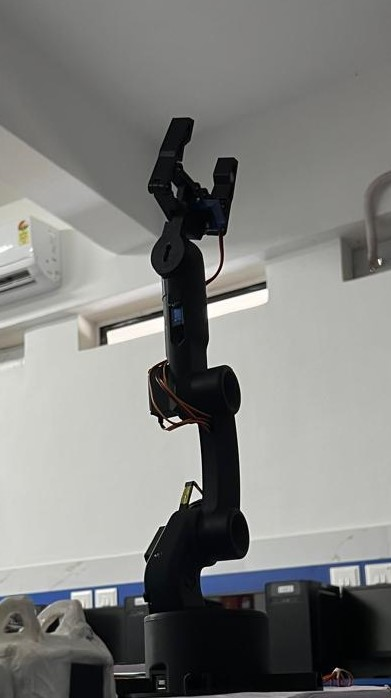
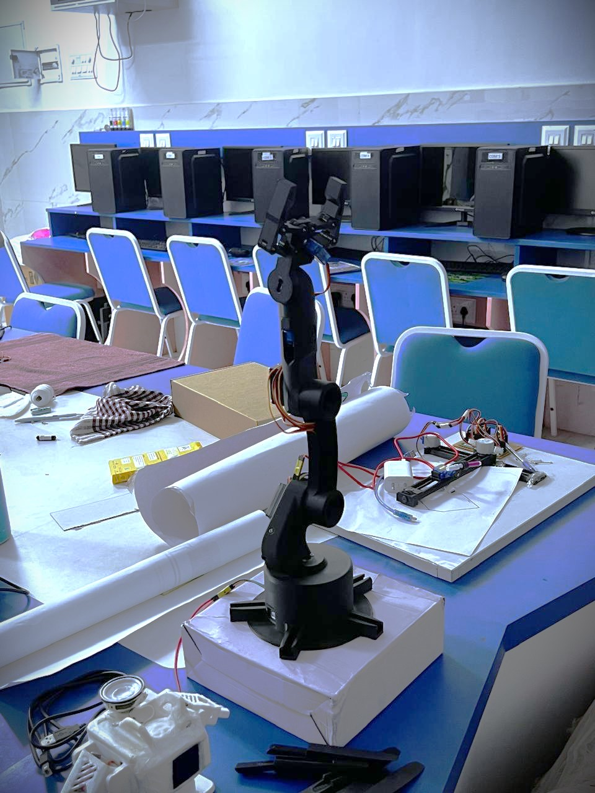

# 6-DOF Robotic Arm

A 6-axis robotic arm that can be controlled remotely through a website or a game controller, built around an Arduino Uno. Made by [Pranav Unnikrishnan and Jeff Velso for our Class 12 (CBSE) school robotics exhibition.

## Overview
We built a robotic arm with six motors that can pick up and move objects using remote control. It demonstrates the basics of industrial automation and robotics: mechanical structure, motor control, and a simple user interface.

## Features
- 6 degrees of freedom (6 motors, [SG90, MG996R, MG90S])
- Controlled from a web interface
- Can also connect to a controller (PowerA Battle Dragon Controller)
- Arduino Uno as the main controller
- Pick-and-place of small objects
- 3D printed parts
- Save positions, movements, and play them in a sequence for performing repetitive tasks

## Hardware
- Arduino Uno
- 2 x SG90, 1 x MG90S, 3 x MG996R
- 5V, 6A
- Body(Base, Shoulder, Elbow, Wrist, Gripper), jumper wires, 
- Mechanical design files: purchased from FABRI creator

## Software
- Arduino code that drives the motors
- Website for remote control ()
- The software was written by Jeff Velso with AI assistance , then modified and tested by both of us.

## How it works
The website or controller sends the target angle for each joint to the Arduino. The Arduino then moves each motor to that position, which moves the arm

## Our roles
We built this project together as a team. Both of us:
- Sourced and bought the components and mechanical design files
- Assembled the arm and wired the electronics
- Calibrated and tested the motors and joints
- Troubleshot problems during the build
- Presented the project at the exhibition

The control software (Arduino code and website) was written and modified using AI assistance (Claude Code).

## Challenges and solutions
- **Gripper Motor Malfunction:** The cog wheels inside the motor were lose and could not move. We opened the motor and tightened the wheels to make it function properly again
- **Power:** The motors at the top portion of the robot did not get enough power due to the adapter being 5V and 5A (instead of 5V and 6A). We changed the adapter accordingly

## What I learned
- How a multi-joint robotic arm is built and wired
- How motors are controlled using an Arduino
- How to debug hardware and software problems together
- How individual parts are designed using CAD softwares

## Future improvements
- Learn CAD properly and design and 3D print some parts myself
- Improve the smoothness and accuracy of movement
- Upgrade the robot by adding gesture control

## Demo
in process...

## Credits
- Mechanical design: FABRI creator
- Software: Jeff Velso, with AI assistance
- Built for the Class 12 school robotics exhibition, Notre Dame School Vasai, 2026
